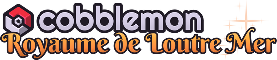

<a id="readme-top"></a>

<br/>
<div align="center">
  <a href="https://github.com/L-Antre-des-Loutres/Cobblemon-RLM">
    
  </a>

  <h3>Cobblemon RLM</h3>

  <p>
    Des formes régionales, des Fakemons et des Méga-Évolutions du Royaume de Loutre Mer pour Cobblemon.
    <br/>
    <a href="https://antredesloutres.fr/pokemon/wiki/pokedex/"><strong>Explorer le Pokédex »</strong></a>
    <br/><br/>
    <a href="https://modrinth.com/project/cobblemon-rlm">Télécharger</a> |
    <a href="https://github.com/L-Antre-des-Loutres/Cobblemon-RLM/issues/new">Signaler un bug</a> |
    <a href="https://github.com/L-Antre-des-Loutres/Cobblemon-RLM/issues">Proposer une idée</a>
  </p>

  <a href="https://modrinth.com/project/cobblemon-rlm"></a>
  
  
  

  <p><a href="README_en.md">English version</a></p>
</div>
<br/>

Créé par l'**Antre des Loutres**, **Cobblemon RLM** enrichit [Cobblemon](https://cobblemon.com) avec les Pokémon de notre univers, leurs talents et leurs capacités exclusives.

> Depuis la version **1.7.0**, le datapack et ses ressources sont intégrés à un **mod**. Il s'installe avec un fichier `.jar` pour Fabric ou NeoForge et comprend les objets de méga-gemmes.

## Sommaire

- [Les ajouts de l'addon](#addon)
- [Installation](#installation)
- [Objets, recettes et commandes](#usage)
- [Développement](#development)
- [Contact](#contact)
- [Contributeurs et crédits](#contributors)

<a id="addon"></a>

## Les ajouts de l'addon

<details>
  <summary>Découvrir les formes régionales RLM</summary>

### Méganium RLM — Plante / Acier

Gardien au tempérament féroce, il réserve sa loyauté aux Dresseurs qui ont gagné son respect. Sa famille comprend **Germignon** et **Macronium RLM**.

Son talent **Rempart Floracier** punit les attaques de contact et pose des Picots. Sa capacité **Charge Floracier** permet également de poser des Picots en attaquant.

### Tortank RLM — Eau / Vol

Ses canons deviennent des propulseurs qui le projettent dans les airs. **Carapuce** et **Carabaffe RLM** apprennent déjà à maîtriser les courants ascendants.

Son talent **Trombe Marine** invoque la pluie et renforce ses statistiques offensives. **Haute Propulsion** lui offre une attaque Vol prioritaire.

### Pingoléon RLM — Eau / Électrik

Habituellement calme, il déchaîne des torrents d'électricité lorsqu'il se met en colère. Il est accompagné de **Tiplouf** et **Prinplouf RLM**.

### Goupelin RLM — Feu / Fée

Magicien malicieux des bois, il joue des tours aux voyageurs tout en guidant les égarés. **Feunnec** et **Roussil RLM** partagent son affinité pour la magie.

Son talent **Psycho-Prio** augmente sa priorité lorsqu'il possède plus de la moitié de ses PV. **Échange Psychomagique** lui permet de retourner les changements de statistiques à son avantage.

### Pharamp RLM — Électrik / Spectre

L'orbe de sa queue guide les âmes égarées vers l'au-delà. **Wattouat** et **Lainergie RLM** arborent eux aussi un pelage chargé d'énergie spectrale.

### Tarinorme RLM — Roche / Fée

Véritable habitué des plages, il aime se prélasser aux côtés des humains. **Tarinor RLM** partage son caractère décontracté et son double type.

### Spiritomb RLM — Feu / Ténèbres

Installé dans une statue Jizo et portant un masque d'Oni, il repousse les mauvais esprits. Son talent **Relâchement des Âmes** riposte en fonction du nombre d'alliés KO.

### Luxray RLM — Glace

Depuis les sommets enneigés, il veille sur les **Lixy** et **Luxio RLM** de sa meute. Sa capacité **Glissade Givrée** frappe avec une priorité de +2.

### Togekiss RLM — Fée / Dragon

Marqué par les conflits humains, il lutte contre une rage draconique. **Togepi** et **Togetic RLM** puisent eux aussi dans cette énergie ancestrale.

Son talent **Dragonate** transforme ses capacités Normal en capacités Dragon et augmente leur puissance.

### Ningale, Ninjask et Munja RLM

- **Ningale — Insecte / Eau** : vit près des berges et se déplace à la surface de l'eau.
- **Ninjask — Eau / Vol** : traverse les lacs à une vitesse fulgurante grâce à ses pattes palmées.
- **Munja — Eau / Roche** : sa carapace se mêle aux coraux et aux fossiles sous-marins. **Garde Émoussée** le protège des attaques neutres ou super efficaces.

### Mysdibule RLM — Poison / Fée ou Dragon / Fée

Deux variantes issues de **Minibule** : la forme **Poison** canalise une aura toxique, tandis que la forme **Dragon** développe une mâchoire capable de déchaîner des attaques dévastatrices. Chacune possède sa propre Méga-Évolution.

### Héliatronc RLM — Trois formes

- **Ciel — Plante / Vol** : prétend avoir été le maître de Rayquaza.
- **Océan — Plante / Eau** : affirme avoir vaincu Kyogre en duel.
- **Volcan — Plante / Feu** : se présente comme le meilleur ami de Groudon.

Leurs récits restent aussi impressionnants que difficiles à vérifier !

### Tranchodon RLM — Dragon / Poison

Ses lames sont imprégnées d'un poison mortel. Sa famille comprend **Coupenotte** et **Incisache RLM**, de type **Dragon / Normal**.

Son talent **Venincisif** renforce les attaques tranchantes et peut empoisonner leur cible. Sa capacité **Hache Draconique** inflige des dégâts en échange d'une baisse de Défense.

</details>

<details>
  <summary>Découvrir les Fakemons</summary>

| Pokémon | Type | Présentation |
|---------|------|--------------|
| **Flammiko** | Feu / Électrik | Maladroit mais amical, il ferait tout pour protéger ses amis. Possède une Méga-Évolution. |
| **Apheos** | Fée / Vol | Un petit Pokémon ambitieux qui rêve de devenir un gardien des cieux. Évolue en Aphelis au niveau 33. |
| **Aphelis** | Fée / Vol | Un gardien fier et protecteur qui défend les Pokémon contre les braconniers. |
| **Rhinécaille** (`rineshell`) | Normal | Têtu et courageux, il attend que sa carapace métallique se développe. Évolue en Galama au niveau 26. |
| **Galama** | Acier / Normal | Un Pokémon paisible dont le casque naturel offre un abri aux plus petits. |
| **Kotora** | Électrik / Fée | Disponible par commande ; aucune apparition naturelle n'est définie dans le pack. |
| **Ptimek** (`tinywone`) | Insecte | Médite chaque jour pour devenir plus fort. Évolue en Guerriek au niveau 15. |
| **Guerriek** (`wamek`) | Insecte / Combat | Un combattant qui continue de s'entraîner après son évolution. Possède une Méga-Évolution. |
| **Minibule** (`smowile`) | Fée | Une pré-évolution timide de Mysdibule, capable d'évoluer vers ses variantes RLM. |

Les identifiants entre parenthèses sont les noms à utiliser dans les commandes.

</details>

<details>
  <summary>Consulter les talents exclusifs</summary>

| Talent | Effet |
|--------|-------|
| **Dragonate** | Transforme les capacités Normal compatibles en type Dragon et augmente leur puissance de 20 %. |
| **Garde Émoussée** | Bloque les attaques neutres ou super efficaces ; les capacités de statut ne sont pas bloquées. |
| **Trombe Marine** | Invoque la pluie à l'entrée en combat. Sous la pluie, l'Attaque et l'Attaque Spéciale sont multipliées par 1,5. |
| **Mystiforce** | Double l'Attaque Spéciale. |
| **Psycho-Prio** | Ajoute +1 à la priorité des capacités tant que les PV dépassent 50 %. |
| **Armure Venimeuse** | Augmente la Défense Spéciale de 50 % et donne 50 % de chances d'empoisonner l'attaquant au contact. |
| **Relâchement des Âmes** | Une fois par combat, après une attaque subie, inflige à l'attaquant 10 % de ses PV max par allié KO. |
| **Rempart Floracier** | Après une attaque de contact subie, retire 1/8 des PV max de l'attaquant et pose une rangée de Picots de son côté. |
| **Venincisif** | Renforce les attaques tranchantes de 50 % et leur donne 20 % de chances d'empoisonner la cible. |

</details>

<details>
  <summary>Consulter les capacités exclusives</summary>

| Capacité | Type | Caractéristique |
|----------|------|-----------------|
| **Charge Floracier** | Plante | Attaque physique qui pose une rangée de Picots du côté adverse. |
| **Électro-Siphon** | Électrik | Attaque physique de puissance 110 et de précision 90 %. |
| **Glissade Givrée** | Glace | Attaque physique de puissance 80 et de priorité +2. |
| **Haute Propulsion** | Vol | Attaque physique de puissance 90, de priorité +1, avec des dégâts de recul. |
| **Échange Psychomagique** | Fée | Vole les augmentations de statistiques de la cible et lui transfère les baisses du lanceur. |
| **Exploroc** | Roche | Attaque explosive qui met le lanceur KO et peut poser les Pièges de Roc du côté adverse. Ajoutée au répertoire de Grolem. |
| **Hache Draconique** | Dragon | Attaque tranchante de puissance 90 qui baisse la Défense du lanceur d'un niveau. |

</details>

<details>
  <summary>Découvrir les Méga-Évolutions RLM</summary>

Les Méga-Évolutions nécessitent [**Cobblemon: Mega Showdown**](https://modrinth.com/mod/cobblemon-mega-showdown). Les formes régionales et les Fakemons restent utilisables sans lui.

| Pokémon | Type | Talent | Gemme |
|---------|------|--------|-------|
| **Méga-Pharamp RLM** | Électrik / Feu | Marque Ombre | Pharampite RLM |
| **Méga-Flammiko** | Feu / Électrik | Simple | Flammikite |
| **Méga-Mysdibule RLM (Poison)** | Poison / Fée | Armure Venimeuse | Mysdibulite RLM (Poison) |
| **Méga-Mysdibule RLM (Dragon)** | Dragon / Fée | Mystiforce | Mysdibulite RLM (Dragon) |
| **Méga-Guerriek** | Insecte / Dragon | Dragonate | Guerriekite |

</details>

<details>
  <summary>Pokédex et succès</summary>

Le pack comprend des entrées de Pokédex pour ses Pokémon et leurs formes, ainsi qu'une progression de succès consacrée aux captures : premiers Pokémon RLM, Fakemons, familles régionales, formes d'Héliatronc et Pokémon chromatiques.

Retrouvez les fiches des Pokémon dans le [**Pokédex de l'Antre des Loutres**](https://antredesloutres.fr/pokemon/wiki/pokedex/).

</details>

<p align="right"><a href="#readme-top">Retour en haut</a></p>

<a id="installation"></a>

## Installation

La version actuelle du projet cible **Minecraft 1.21.1**, **Java 21** et **Cobblemon 1.8.2**.

| Dépendance | Nécessaire ? |
|------------|--------------|
| [Cobblemon](https://modrinth.com/mod/cobblemon) et ses dépendances | Oui |
| Fabric ou NeoForge | Oui, selon le fichier RLM choisi |
| [Fabric API](https://modrinth.com/mod/fabric-api) | Oui sur Fabric |
| [Cobblemon: Mega Showdown](https://modrinth.com/mod/cobblemon-mega-showdown) et ses dépendances | Pour les Méga-Évolutions et les recettes de méga-gemmes |

La compatibilité de développement utilise Fabric Loader **0.19.5**, NeoForge **21.1.251** et Mega Showdown **1.3.0+1.8.2+1.21.1-hotfix**.

<details>
  <summary>Installer avec Modrinth App</summary>

1. Créez ou ouvrez une instance **Minecraft 1.21.1** avec **Fabric** ou **NeoForge**.
2. Ajoutez **Cobblemon 1.8.2** et ses dépendances, ainsi que **Fabric API** si vous utilisez Fabric.
3. Depuis la [page de Cobblemon RLM](https://modrinth.com/project/cobblemon-rlm), choisissez le fichier correspondant à votre chargeur et ajoutez-le à cette instance.
4. Ajoutez **Mega Showdown** et ses dépendances si vous souhaitez utiliser les Méga-Évolutions.
5. Lancez le jeu et ouvrez votre monde.

</details>

<details>
  <summary>Installer manuellement, en solo ou sur un serveur</summary>

1. Installez **Fabric** ou **NeoForge** pour Minecraft **1.21.1**, puis **Cobblemon 1.8.2** et ses dépendances.
2. Téléchargez le `.jar` de **Cobblemon RLM** pour votre chargeur depuis [Modrinth](https://modrinth.com/project/cobblemon-rlm).
3. Placez ce fichier dans le dossier **`mods/`** de votre instance Minecraft.
4. Pour jouer sur un serveur, installez également le mod et ses dépendances dans le dossier **`mods/`** du serveur. Le client et le serveur doivent utiliser des versions compatibles.
5. Installez **Mega Showdown** si vous souhaitez utiliser les Méga-Évolutions et fabriquer les méga-gemmes.
6. Redémarrez le jeu ou le serveur.

Les données, modèles et textures sont inclus dans le mod : aucun pack de ressources supplémentaire n'est nécessaire.

</details>

<details>
  <summary>Mettre à jour depuis l'ancien datapack</summary>

Retirez l'ancien ZIP RLM du dossier **`datapacks/`** du monde, son éventuel pack de ressources séparé et l'ancien JAR RLM du dossier **`mods/`**, puis installez le nouveau mod.

Les nouveaux objets de méga-gemmes nécessitent le mod : placer son fichier dans `datapacks/` ou `resourcepacks/` ne remplace pas son installation dans `mods/`.

Les anciennes gemmes basées sur des teintures conservent leurs modèles et leurs données. Les nouveaux crafts produisent les vrais objets RLM ; les anciens inventaires ne sont pas convertis automatiquement.

</details>

<p align="right"><a href="#readme-top">Retour en haut</a></p>

<a id="usage"></a>

## Objets, recettes et commandes

<details>
  <summary>Fabriquer les méga-gemmes</summary>

Les cinq gemmes sont disponibles dans l'onglet créatif **Cobblemon RLM**. Avec Mega Showdown installé, elles peuvent aussi être fabriquées dans une **table de forge**.

Placez une **Méga-Pierre** (`mega_showdown:mega_stone`) dans l'emplacement de base, puis les gemmes Cobblemon indiquées ci-dessous dans les premier et troisième emplacements.

| Résultat | Premier emplacement | Base | Ajout |
|----------|---------------------|------|-------|
| **Pharampite RLM** | Gemme Électrik | Méga-Pierre | Gemme Spectre |
| **Flammikite** | Gemme Feu | Méga-Pierre | Gemme Électrik |
| **Mysdibulite RLM (Dragon)** | Gemme Dragon | Méga-Pierre | Gemme Fée |
| **Mysdibulite RLM (Poison)** | Gemme Poison | Méga-Pierre | Gemme Fée |
| **Guerriekite** | Gemme Insecte | Méga-Pierre | Gemme Dragon |

Sans Mega Showdown, les objets restent présents dans l'onglet créatif, mais leurs recettes et leurs effets de Méga-Évolution sont désactivés.

</details>

<details>
  <summary>Obtenir des Pokémon et des gemmes par commande</summary>

Ces commandes nécessitent les commandes activées en solo ou les permissions appropriées sur le serveur. Les noms d'espèces et les aspects utilisent leurs identifiants, même lorsque le jeu est en français.

```mcfunction
/pokegive @s flammiko
/pokegive @s rineshell
/pokegive @s tinywone
/pokegive @s wamek
/pokegive @s smowile
/pokegive @s kotora
/pokegive @s delphox rlm
/pokegive @s mawile rlm dragon
/pokegive @s mawile rlm poison
/pokegive @s sunflora rlm ciel
/pokegive @s sunflora rlm ocean
/pokegive @s sunflora rlm volcan
```

Pour Goupelin RLM, l'aspect `rlm=true` fonctionne également. Sans cet aspect, `/pokegive @s delphox` donne la forme normale, y compris lorsque Mega Showdown est installé.

```mcfunction
/give @s rlm_megas:ampharositerlm
/give @s rlm_megas:flammikite
/give @s rlm_megas:mawiliterlmdragon
/give @s rlm_megas:mawiliterlmpoison
/give @s rlm_megas:wamekite
```

Avec Mega Showdown installé, les gemmes obtenues par commande ou depuis l'onglet créatif reçoivent automatiquement les composants nécessaires à la Méga-Évolution.

</details>

<p align="right"><a href="#readme-top">Retour en haut</a></p>

<a id="development"></a>

## Développement

<details>
  <summary>Compiler le mod et lancer un environnement de développement</summary>

Utilisez un **JDK 21** et configurez `JAVA_HOME` vers ce JDK. Le wrapper Gradle est fourni dans le dépôt.

```sh
# Linux / macOS
./gradlew build
```

```powershell
# Windows
.\gradlew.bat build
```

Les deux mods installables sont regroupés dans **`build/libs/`** :

- `cobblemon-rlm-fabric-1.7.0.jar`
- `cobblemon-rlm-neoforge-1.7.0.jar`

Les versions sont centralisées dans [`gradle.properties`](gradle.properties). L'option `-Prelease_version=1.7.1` permet de remplacer la version lors d'une compilation pour publication.

| Module | Rôle |
|--------|------|
| [`common`](common) | Code partagé, objets, compatibilité Mega Showdown et ressources `assets/` et `data/` |
| [`fabric`](fabric) | Enregistrement Fabric, onglet créatif et métadonnées |
| [`neoforge`](neoforge) | Enregistrement NeoForge, onglet créatif et métadonnées |

Les sources communes sont compilées dans chaque mod. RLM n'ajoute pas de dépendance Architectury ; le JAR du module `common` ne doit pas être installé.

Pour lancer un client de développement :

```sh
./gradlew :fabric:runClient
./gradlew :neoforge:runClient
```

Sur Windows, remplacez `./gradlew` par `.\gradlew.bat`. Les tâches `:fabric:runServer` et `:neoforge:runServer` sont également disponibles.

Ces environnements chargent **Cobblemon**, **Mega Showdown**, **Cobblemon Trainers 1.1.0** et **JEI 19.27.0.340** par défaut. Utilisez `-PwithCobblemonTrainers=false` pour tester sans les dresseurs. Kotlin for Forge 5.12.0 est utilisé sur NeoForge. Utilisez `-PwithMegaShowdown=false` pour tester sans Mega Showdown. Ces dépendances de développement ne sont pas incluses dans les JAR distribués. La version de JEI est définie par `jei_version` ; redémarrez le jeu après sa modification.

Les clients utilisent jusqu'à **4 Go de mémoire** et ouvrent automatiquement la sauvegarde **`RLM-Test`** si elle existe dans le dossier `runs/client/saves/` du module. L'option `-PquickPlayWorld=` permet de revenir au menu principal.

Lorsqu'il a été généré localement, le fichier `build/client-test/Cobblemon-RLM-Test-1.7.0.mrpack` peut être importé dans Modrinth App. Il contient le mod Fabric, ses dépendances, JEI et le monde créatif **« RLM 1.7.0 - Test creatif »**, avec les cinq méga-gemmes et un Méga-Bracelet dans la barre rapide.

</details>

<details>
  <summary>Lancer les clients depuis IntelliJ IDEA</summary>

1. Ouvrez la racine du dépôt et importez le projet **Gradle**.
2. Dans **Settings → Build, Execution, Deployment → Build Tools → Gradle**, sélectionnez le **wrapper Gradle** et un **JDK 21** comme Gradle JVM.
3. Rechargez le projet Gradle, puis choisissez **RLM - Client Fabric** ou **RLM - Client NeoForge**.
4. Cliquez sur **Run ▶** pour lancer le client et consulter les journaux dans la fenêtre **Run**.

Les configurations sont partagées dans [`.run/`](.run). Les tâches `runClient` peuvent aussi être lancées depuis la fenêtre Gradle.

</details>

<details>
  <summary>Ajouter une gemme et suivre les versions</summary>

Pour ajouter une gemme, complétez l'énumération [`MegaGem`](common/src/main/java/fr/antredesloutres/cobblemonrlm/item/MegaGem.java), ses modèles, textures et traductions, sa recette dans [`data/rlm_megas/recipe/`](common/src/main/resources/data/rlm_megas/recipe) et le tag [`rlm_megas:mega_gems`](common/src/main/resources/data/rlm_megas/tags/item/mega_gems.json).

Les conditions de présence de Mega Showdown sont ajoutées aux recettes lors de la construction des mods Fabric et NeoForge.

Consultez le [changelog](CHANGELOG.md) pour les changements de version et le [guide de publication](.github/RELEASE.md) pour les releases.

</details>

<p align="right"><a href="#readme-top">Retour en haut</a></p>

<a id="contact"></a>

## Contact

Pour poser une question, signaler un bug ou proposer une idée, [ouvrez une issue sur GitHub](https://github.com/L-Antre-des-Loutres/Cobblemon-RLM/issues).

Pour un bug, indiquez les versions de Minecraft, de Cobblemon et de RLM, votre chargeur (**Fabric** ou **NeoForge**), la présence éventuelle de Mega Showdown, les étapes pour reproduire le problème et les journaux utiles.

Retrouvez également le projet et son univers sur le [site de l'Antre des Loutres](https://antredesloutres.fr).

<p align="right"><a href="#readme-top">Retour en haut</a></p>

<a id="contributors"></a>

## Contributeurs et crédits

| Contribution | Crédit |
|--------------|--------|
| **Projet et univers RLM** | [Antre des Loutres](https://antredesloutres.fr) |
| **Design et développement** | [TheAzertor](https://github.com/Corentin-cott) · [RereBleue](https://github.com/matheo-1712) |
| **Modèles et textures de base** | [Cobblemon](https://cobblemon.com) |

<a href="https://github.com/L-Antre-des-Loutres/Cobblemon-RLM/graphs/contributors">
  
</a>

<p align="right"><a href="#readme-top">Retour en haut</a></p>

## Dresseurs et Méga-Gemmes

[Cobblemon Trainers](https://modrinth.com/mod/cobblemon-trainers-rerebleue) est une dépendance optionnelle. Avec ce mod installé, cinq dresseurs apparaissent dans la catégorie « Maîtres des Méga-Gemmes RLM » du Battle Phone. Ils peuvent être appelés dans les plaines ; chacun possède un Pokémon niveau 50 tenant sa gemme RLM : Pharamp RLM, Flammiko, Mysdibule RLM Dragon, Mysdibule RLM Poison ou Guerriek.

Mega Showdown est également nécessaire pour leur Méga-Évolution. Les équipes utilisent les identifiants complets des objets (`@ rlm_megas:flammikite`, par exemple) et `battle.gimmicks: ["mega"]`. Les gemmes RLM existent aussi sans Mega Showdown : elles restent alors tenues, mais aucune Méga-Évolution ne se déclenche.

Pour un test administrateur : `/cobblemontrainers spawn cobblemonrlm:mega_trainers/flammiko`, puis `/cobblemontrainers debugai`. Vérifier en combat la transformation au premier tour. Le support des objets externes est confirmé dans le [parseur de Cobblemon Trainers](https://github.com/matheo-1712/cobblemon-trainers/blob/master/common/src/main/kotlin/matheo1712/cobbletrainers/parser/ShowdownTeamParser.kt) et les conditions sont décrites dans son [guide des gimmicks](https://github.com/matheo-1712/cobblemon-trainers/blob/master/docs/GIMMICKS.md).
